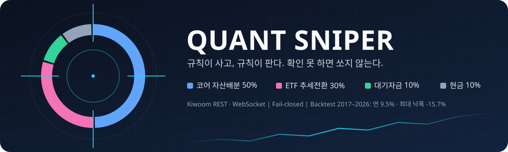

# Quant Sniper

<p align="center"></p>

<p align="center"><b>
<a href="https://github.com/rundevelrun/quant-sniper/tree/dashboard">Dashboard</a>&nbsp;&nbsp;&nbsp;·&nbsp;&nbsp;&nbsp;<a href="#한눈에-보기">한눈에 보기</a>&nbsp;&nbsp;&nbsp;·&nbsp;&nbsp;&nbsp;<a href="#백테스트-근거-2017-01--2026-11">백테스트</a>&nbsp;&nbsp;&nbsp;·&nbsp;&nbsp;&nbsp;<a href="#운영-시간표">운영 시간표</a>&nbsp;&nbsp;&nbsp;·&nbsp;&nbsp;&nbsp;<a href="#대시보드와-모니터링">설치</a>&nbsp;&nbsp;&nbsp;·&nbsp;&nbsp;&nbsp;<a href="LICENSE">License</a>
</b></p>

<p align="center"><a href="https://github.com/rundevelrun/quant-sniper/tree/dashboard"></a>&nbsp;&nbsp;<a href="https://github.com/rundevelrun/quant-sniper/tree/dashboard"></a><br><br></p>

> **내가 매수 버튼을 누르는 게 가장 큰 리스크라서 만든 프로젝트.**

키움증권 REST·WebSocket API로 한국 주식 계좌를 운용하는 실전 자동매매 시스템입니다. 미리 정한 진입·청산·자금관리 규칙만 실행하고, 조건이 불명확하거나 데이터가 부족하면 주문하지 않습니다. 실제 손실이 날 수 있음을 알고, 감정적으로 직접 매매하는 것보다 규칙과 손실 한도가 있는 편이 낫다고 판단해 운영합니다.

모의투자 경로는 없습니다. `LIVE_TRADING_ENABLED=true`와 실전 인증정보가 있어야만 실행됩니다.

[운영 대시보드 보기](https://github.com/rundevelrun/quant-sniper/tree/dashboard)

## 한눈에 보기

| 구분 | 정책 | 계좌 비중 | 상태 |
|---|---|---:|---|
| 코어 | 고정 비중 자산배분(배당주·나스닥·채권·금·달러), 월 1회 리밸런싱 | 50% | 🟢 |
| 추세 | 다중자산 ETF 추세전환(8종 중 가장 강한 1종목) | 최대 30% | 🟢 |
| 대기 | 남는 현금을 CD금리 ETF에 보관 | 나머지 | 🟢 |
| 현금 | 버퍼 | 10% | 🟢 |
| 개별주 | RSI·VBO 신규 매수 | - | ⚪ 비활성(보유분만 청산 감시) |

**설계 원칙**: 규칙 우선 · 확인 못 하면 주문 안 함(fail closed) · 전일 확정 데이터만 사용 · 증권사 체결 기준 기록 · 수익보다 생존 우선 · 상태 공개

## 백테스트 근거 (2017-01 – 2026-11)

| 구성 | 연수익 | 최대 낙폭 | 플러스인 해 | 최악의 해 |
|---|---:|---:|---:|---:|
| **코어 50% + 추세전환 30% (현재)** | 9.5% | -15.7% | 9/10 | -7.9% |
| 코어 50% + 추세전환 35% | 10.4% | -17.1% | 9/10 | -8.2% |
| 코어 50% + 추세전환 40% | 11.3% | -18.6% | 9/10 | -8.6% |
| 코어 100% | 8.2% | -14.9% | 9/10 | -11.0% |
| KODEX 200 보유 | 13.5% | -50.5% | - | - |

추세전환은 운 좋은 설정에 속지 않도록 20개 설정의 평균으로 계산했습니다. 분배금·해외 ETF 매매차익 과세·대기자금 이자는 아직 반영하지 않았고, 과거 성과는 미래 수익을 보장하지 않습니다.

<details>
<summary><b>백테스트 상세</b></summary>

- 코어와 추세전환은 버는 시기가 다릅니다(월간 수익 상관 약 0.5). 추세전환이 제자리였던 2019·2023·2024년에 코어가 벌었고, 코어가 빠진 2022년에 추세전환이 손실을 줄였습니다.
- 코어 비율을 영구 포트폴리오(25%씩)로 바꿔도 결과가 거의 같습니다.
- 추세전환은 900개 설정 조합 모두 두 기간(2017–2021, 2022–2026)에서 플러스였지만, 현재 설정은 그중 상위 1%라 평균값을 기준으로 씁니다.
- 추세전환 수익은 2017·2025·2026년 급등장에 몰려 있고 2018–2024년은 거의 제자리였습니다.
- 추세전환 비중을 30%에서 40%로 올리면 연수익은 늘지만 낙폭이 커지고 위험 대비 수익(샤프 1.08 → 1.04)은 낮아져 30%를 유지합니다.
- 백테스트는 같은 자산의 KODEX·KIWOOM ETF로 계산했고, 실전은 추세전환과 코드가 겹치지 않는 TIGER·ACE ETF를 씁니다(2020-11 이후 실전 ETF로 재계산 시 연 8.4% vs 8.3%로 동일).
- 코어 국내주식(TIGER 200)을 국내·미국 월배당 ETF로 나눈 구성은 2012–2026 대체 데이터에서 코어 낙폭이 -15.8%에서 -10.3%로 줄고 수익은 비슷했습니다(`backtest/.cache/yahoo` 프록시).
- 재현: `backtest/static_allocation.py`, `backtest/combo_allocation.py`, `backtest/etf_rotation_backtest.py`, `backtest/etf_robustness.py`

</details>

## 운영 시간표

| 시간 | 봇이 하는 일 |
|---|---|
| 24시간 | 30초마다 감시 루프, `health.json` 기록 |
| 08:30 | 개별주 감시 종목 선정(현재 주문 영향 없음) |
| 09:00–15:30 | 30초마다 잔고 대조·손절 판단, 5분마다 대시보드 갱신 |
| 09:15–15:10 | ETF 추세전환 진입 판단(30초 간격 3회 확인) |
| 10:00–14:30 | 코어 리밸런싱(월 1회, 큰 입출금 시 추가 1회) |
| 15:12–15:18 | 남는 현금을 CD금리 ETF에 편입 |
| 체결 시 | `trades.json`·`positions.json`을 GitHub에 기록 |

watchdog은 평일 09:00–15:32에 1분마다 확인하고 heartbeat가 3분 넘게 멈추면 봇을 재시작합니다.

<details>
<summary><b>코어 자산배분 규칙</b></summary>

| 자산 | ETF | 코어 내 비중 | 계좌 대비 |
|---|---|---:|---:|
| 국내 고배당(월배당) | PLUS 고배당주 | 7.5% | 3.75% |
| 미국 배당(월배당) | TIGER 미국배당다우존스 | 7.5% | 3.75% |
| 미국 주식 | ACE 미국나스닥100 | 15% | 7.5% |
| 국내 채권 | ACE 국고채10년 | 40% | 20% |
| 금 | TIGER 골드선물(H) | 15% | 7.5% |
| 달러 | TIGER 미국달러단기채권액티브 | 15% | 7.5% |

- 매월 첫 거래일 10:00–14:30에 목표 비중으로 맞춤(매도 먼저, 매수 나중)
- 계좌의 10% 이상 입출금이 감지되면 다음 리밸런싱 창에서 한 번 더 맞춤
- 목표와의 차이가 계좌의 1.5% 미만이면 매매하지 않음
- 목표 수량은 가장 가까운 정수 주식으로 반올림, 1주 미만 구간은 1주 값이 목표의 1.5배 이내일 때만 1주 보유
- 현금이 모자라면 대기자금 ETF를 필요한 만큼 먼저 매도
- 손절·타임스탑 없음. 계좌 낙폭 -12% 구간에서는 비중을 늘리지 않음
- `core_state.json`에 기록하고 증권사 수량과 다르면 신규 주문 중단

</details>

<details>
<summary><b>ETF 추세전환 규칙</b></summary>

**선택**: KODEX 200·코스닥150·미국 S&P500·미국 나스닥100·골드선물(H)·국고채3년·미국달러선물·인버스 8종 중, 전일 종가가 60일선 +1% 위이고 60일선이 상승 중인 자산만 후보. 3개월 40% + 6개월 60% 모멘텀이 가장 높은 1종목만 보유하고, 기존 보유보다 2%p 이상 높을 때만 교체. 후보가 없으면 현금.

**진입**: 09:15–15:10, 30초 간격 3회 확인 후 계좌 최대 30%(인버스는 15%). 전일 대비 -3% 넘는 역방향 갭이면 회복 후 진입. 같은 날 이 전략으로 매매했으면 재진입하지 않음. KRX로만 주문.

**청산**: 국면 전환(후보 탈락·교체) 또는 -5% 재해 손절. 단계형 보호선·고점 추적은 쓰지 않음.

</details>

<details>
<summary><b>대기자금(CD금리 ETF) 규칙</b></summary>

- `TIGER CD금리투자KIS(합성)`에 매일 15:12–15:18 한 번, 10% 현금 버퍼를 남기고 남는 현금만 편입
- 매수 자금이 부족하면 필요한 만큼만 먼저 매도
- 종목 수·위험 계산에서는 현금으로 취급, `parking_state.json`에 기록

</details>

<details>
<summary><b>계좌 보호와 주문 안전</b></summary>

- 전체 투자금은 평가자산의 90% 이내, 신용·미수·레버리지 주문 경로 없음
- 일일 손실 -4% 시 당일 신규 주문 중단, 계좌 고점 대비 -12% 시 주문 크기 50%, -20% 시 신규 매수 중단
- 증권사 잔고(`kt00018`)와 로컬 장부가 다르면 신규 주문 차단
- 체결 조회(`kt00009`)로 전량 체결을 확인한 뒤 장부 반영, 부분체결·거절은 성공으로 기록하지 않음
- 계좌 조회 실패 루프는 신규 주문 차단, 다음 조회가 정상이면 재개
- 정규장 실시간 체결이 확인된 경우에만 매매 루프 활성화
- 신규 진입 판단은 15초 이내 시세, 청산 판단은 60초 이내 시세 사용
- 프로세스 잠금으로 중복 실행 차단, 체결 장부 push 실패 시 신규 주문 중단
- 외부 입출금은 키움 입출금 내역(`kt00015`)으로 확인해 원금·계좌 고점에 반영하고, 분배금·이자는 수익으로 계산. 전략 수익률(TWR)은 입출금 영향을 제거
- 주문은 시장가(SOR, ETF는 KRX)

**비용 가정**: ETF는 수수료 0.015%×2 + 슬리피지 0.05%×2. 개별주는 거래세 0.20% + 수수료 0.015%×2 + 슬리피지 0.25%×2.

**정책 변경 규칙**: 실전 손실 직후 규칙을 바꾸지 않습니다. 변경은 주문 안전·장애 대응과, 두 기간 이상 백테스트로 근거가 확인된 경우로 한정합니다.

</details>

<details>
<summary><b>남아 있는 개별주 보유분 청산 규칙</b></summary>

- 진입 시 정한 ATR 기반 손절
- +4% 도달 시 보호선을 매수가 +1%로, +8% 도달 시 고점 추적(최고가 대비 2–4%)
- 비수익 7거래일, 수익 중 14거래일 타임스탑(고점 추적 활성 시 면제)

</details>

<details>
<summary><b>제거·기각한 전략</b></summary>

| 전략 | 결과 |
|---|---|
| 개별주 RSI 과매도 반등 | 206회, 거래당 -1.42%, 승률 34% |
| 개별주 변동성 돌파(VBO) | 322회, 거래당 +0.04%로 비용만 발생 |
| 비우호장 VBO 예외·당일 거래량 급증 스캐너 | 검증 없이 추가된 추격 매수 |
| 섹터 ETF 추세추종 | 다중자산 ETF와 역할 중복 |
| ETF 단계형 보호선·고점 추적 | 매매 2.5배, 거래당 수익 1/4 |
| 가격 기반 개별주 전략 2,288가지 | 두 기간 모두 연 10% 이상·낙폭 -30% 이내 통과 0개 |
| DART 10년 재무 기반 가치주 96조합 | 두 기간 모두 연 10% 이상 통과 0개 |
| 당일 익절/손절 단타(+1–10%, 급등·갭 종목 포함) | 모든 조합 거래당 손실(`backtest/intraday_target_backtest.py`) |

모든 개별주 데이터는 상장폐지 종목이 빠져 있어 실제 결과는 더 나쁠 수 있습니다. 꺼진 전략의 코드는 `config.py` 설정으로 비활성화되어 있으며, 다시 켜려면 백테스트 근거가 필요합니다.

</details>

## 대시보드와 모니터링

공개 [`dashboard` 브랜치](https://github.com/rundevelrun/quant-sniper/tree/dashboard)에 현재 상태, 보유 포지션(수익률·비중·청산 계획), 계좌 안전장치, 전체 성과, 청산 전체 기록, 감시 종목을 표시합니다. 금액·수량은 공개하지 않고 퍼센트만 보여 줍니다.

필자는 Claude Code를 운영 보조로 씁니다. Claude는 직접 주문하지 않고, 봇 규칙과 운영자가 승인한 변경을 통해서만 매매에 관여합니다. 저장소에 포함된 필수 기능은 아닙니다.

| 시점 | Claude가 하는 일 |
|---|---|
| 장중 | 봇 로그·상태 파일을 주기적으로 감시하고, 체결·위험 이벤트·heartbeat 끊김·오류가 생기면 원인을 분석해 휴대폰으로 알림 |
| 장 마감 후 | 당일 운영 점검, 승인된 수정 구현·테스트·재시작, 다음 날 감시 예약 |
| 주말 | 실전 체결과 백테스트 비교, 비용·슬리피지 실측, 버그·리스크 정리, 개선안 백테스트(두 기간 이상에서 유지되는 개선만 제안) |
| 수시 | 현황 보고, 버그 수정, 운영자 요청 백테스트, 일회성 예외 조건 적용 후 실행되면 소스에서 삭제 |

<details>
<summary><b>설치와 실행</b></summary>

요구사항: Linux, Python 3.10 이상, 키움증권 REST API 실전 App Key·Secret, 실전 계좌

```bash
git clone https://github.com/rundevelrun/quant-sniper.git
cd quant-sniper
python3 -m venv venv && source venv/bin/activate
python3 -m pip install -r requirements.txt
cp .env.example .env
```

```env
KIWOOM_APP_KEY=your_app_key
KIWOOM_APP_SECRET=your_app_secret
KIWOOM_ACCOUNT_NO=your_account_number
LIVE_TRADING_ENABLED=false
ORDER_CONFIRM_TIMEOUT_SECONDS=20
AUTO_GIT_PUSH=false
```

테스트 후 `LIVE_TRADING_ENABLED=true`로 실전을 활성화합니다.

```bash
python3 -m unittest discover -s tests -v
python3 bot.py
```

systemd 등록(`quant_sniper.service`는 경로·사용자를 환경에 맞게 수정):

```bash
sudo cp quant_sniper.service quant-sniper-watchdog.service quant-sniper-watchdog.timer /etc/systemd/system/
sudo systemctl daemon-reload
sudo systemctl enable --now quant_sniper quant-sniper-watchdog.timer
```

</details>

<details>
<summary><b>시스템 구조와 키움 API 사용 범위</b></summary>

```text
키움 REST 일봉·계좌·주문 ─┐
                           ├─> 전략 평가 → 위험 한도 검사 → 주문 → 체결 확인
키움 WebSocket 실시간 체결 ┘                         │
                                                     ├─> main: 체결 장부
                                                     └─> dashboard: 상태·성과
```

| API | 용도 |
|---|---|
| OAuth | 접근 토큰 발급 |
| `ka10031`, `ka10100`, `ka10081` | 거래 순위, 종목정보, 일봉 |
| `0B` (WebSocket) | 실시간 체결가·장 구분 |
| `kt00001`, `kt00018`, `kt00009` | 주문 가능 금액, 계좌 평가, 체결 확인 |
| `kt10000`, `kt10001` | 시장가 매수·매도 |

| 파일 | 역할 |
|---|---|
| `bot.py` | 거래·위험관리·대시보드 루프 |
| `config.py` | 전략·자금관리 파라미터 |
| `kiwoom_api.py`, `kiwoom_realtime.py` | 키움 REST·WebSocket 클라이언트 |
| `watchdog.py` | 장중 heartbeat 감시 |
| `backtest/` | 백테스트와 데이터 수집 |
| `tests/` | 안전장치·전략 테스트 |
| `trades.json`, `positions.json` | 체결 장부, 매매 포지션 |

`research_data.db`(로컬 전용)에 시장 국면·감시 후보·보유 포지션을 5분 단위로 누적합니다. 인증정보·계좌번호는 기록하지 않습니다.

이 프로젝트는 키움증권의 공식 제품이 아니며, API 규격과 이용 조건은 키움증권 공식 문서를 확인해야 합니다.

</details>

## 보안과 책임

- `.env`, API Key·Secret, 계좌번호를 커밋하지 마십시오. 노출되면 즉시 재발급하십시오.
- 수익을 보장하지 않으며 투자 자문이 아닙니다. 비용·슬리피지·갭·API 장애로 계획보다 큰 손실이 날 수 있습니다.
- 규칙은 사전 고지 없이 바뀔 수 있습니다. 실제 계좌에서 실행할 책임과 손익은 사용자에게 있습니다.

[MIT License](LICENSE)
