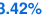
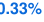
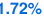
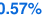

<b><a href="https://github.com/rundevelrun/quant-sniper">← 프로젝트 README</a>&nbsp;&nbsp;&nbsp;·&nbsp;&nbsp;&nbsp;<a href="https://github.com/rundevelrun/quant-sniper#한눈에-보기">전략 한눈에 보기</a>&nbsp;&nbsp;&nbsp;·&nbsp;&nbsp;&nbsp;<a href="https://github.com/rundevelrun/quant-sniper#백테스트-근거-2017-01--2026-11">백테스트</a>&nbsp;&nbsp;&nbsp;·&nbsp;&nbsp;&nbsp;<a href="https://github.com/rundevelrun/quant-sniper#운영-시간표">운영 시간표</a></b>

> 마지막 갱신: **2026-11-29 01:00:20 KST**  
> 갱신 주기: **보유 중 매 5분 10초(00·05·10…분) · 상태/신호/거래 변경 즉시 · 무보유·무변화 시 00분 10초·30분 10초**

## 현재 상태

| 시스템 | 장 운영 | 시장 국면 | 신규 매수 | 보유 포지션 |
|---|---|---|---|---:|
| 🟢 정상 | 🔴 CLOSED | KODEX 인버스 | 중단 | 매매 1 · 코어 6 · 대기 1 |

> 정규장 운영 시간 외 · 키움 실시간 정상 · 마지막 계좌 확인 2026-11-27 15:20:06

> 개별주: 개별주 전략 비활성화(보유분만 청산 감시)

> 현금 대기: TIGER CD금리투자KIS(합성) · 계좌 비중 15.0% · 수익률 +0.00%

## 전략별 현재 판단

| 전략 | 상태 | 대상 | 판단 근거 |
|---|---|---|---|
| ETF 추세전환 | 보유 중 | KODEX 인버스 | 전일 확정 3/6개월 모멘텀·60일선·교체 완충 |

## 현재 보유 포지션

<table width="100%">
<thead><tr>
<th width="17%">종목</th><th width="14%">전략</th>
<th width="76" nowrap align="center">수익률</th>
<th width="12%" nowrap>비중</th><th width="8%">보유 기간</th>
<th width="11%">현재 보호</th><th width="30%">청산 계획</th>
</tr></thead><tbody>
<tr><td>PLUS 고배당주</td><td>코어 자산배분</td><td width="76" nowrap align="center" valign="middle"></td><td align="right" nowrap>5.4% (목표 3.8%)</td><td align="right">1일</td><td>없음(장기 보유)</td><td>월 1회 리밸런싱(목표 비중 초과분만 매도)</td></tr>
<tr><td>TIGER 미국배당다우존스</td><td>코어 자산배분</td><td width="76" nowrap align="center" valign="middle"></td><td align="right" nowrap>3.9% (목표 3.8%)</td><td align="right">1일</td><td>없음(장기 보유)</td><td>월 1회 리밸런싱(목표 비중 초과분만 매도)</td></tr>
<tr><td>KODEX 인버스</td><td>ETF 추세전환</td><td width="76" nowrap align="center" valign="middle"></td><td align="right" nowrap>24.1%</td><td align="right">2일</td><td>재해 손절</td><td>국면 전환 · -5.0% 재해 손절</td></tr>
<tr><td>ACE 미국나스닥100</td><td>코어 자산배분</td><td width="76" nowrap align="center" valign="middle"></td><td align="right" nowrap>7.0% (목표 7.5%)</td><td align="right">2일</td><td>없음(장기 보유)</td><td>월 1회 리밸런싱(목표 비중 초과분만 매도)</td></tr>
<tr><td>ACE 국고채10년</td><td>코어 자산배분</td><td width="76" nowrap align="center" valign="middle"></td><td align="right" nowrap>22.3% (목표 20.0%)</td><td align="right">2일</td><td>없음(장기 보유)</td><td>월 1회 리밸런싱(목표 비중 초과분만 매도)</td></tr>
<tr><td>TIGER 골드선물(H)</td><td>코어 자산배분</td><td width="76" nowrap align="center" valign="middle"></td><td align="right" nowrap>5.5% (목표 7.5%)</td><td align="right">2일</td><td>없음(장기 보유)</td><td>월 1회 리밸런싱(목표 비중 초과분만 매도)</td></tr>
<tr><td>TIGER 미국달러단기채권액티브</td><td>코어 자산배분</td><td width="76" nowrap align="center" valign="middle"></td><td align="right" nowrap>6.5% (목표 7.5%)</td><td align="right">2일</td><td>없음(장기 보유)</td><td>월 1회 리밸런싱(목표 비중 초과분만 매도)</td></tr>
<tr><td>TIGER CD금리투자KIS(합성)</td><td>대기자금</td><td width="76" nowrap align="center" valign="middle"></td><td align="right" nowrap>15.0%</td><td align="right">-</td><td>없음(장기 보유)</td><td>매수 자금 부족 시 필요한 만큼만 매도</td></tr>
</tbody></table>

## 계좌 안전장치

<table width="100%">
<thead><tr>
<th width="14%">신규 매수</th><th width="24%">계좌 고점 대비 낙폭</th>
<th width="76" nowrap align="center">오늘 수익률</th>
<th width="76" nowrap align="center">누적 수익률</th>
<th width="76" nowrap align="center">전략 수익률 (TWR)</th>
<th width="14%">주문 배율</th>
<th width="14%">남은 슬롯</th>
</tr></thead><tbody><tr>
<td>중단</td>
<td align="right">1.05%</td>
<td width="76" nowrap align="center" valign="middle"></td>
<td width="76" nowrap align="center" valign="middle"></td>
<td width="76" nowrap align="center" valign="middle"></td>
<td align="right">100%</td>
<td align="right">4</td>
</tr></tbody></table>

## 전체 성과

<table width="100%">
<thead><tr>
<th>청산 거래</th><th>승률</th>
<th width="76" nowrap align="center">거래가중 순수익률</th>
<th width="76" nowrap align="center">평균 이익률</th>
<th width="76" nowrap align="center">평균 손실률</th>
<th>Profit Factor</th><th>최대 연속 손실</th><th>거래가중 비용률</th>
</tr></thead><tbody><tr>
<td align="center">6</td>
<td align="center">66.7%</td>
<td width="76" nowrap align="center" valign="middle"></td>
<td width="76" nowrap align="center" valign="middle"></td>
<td width="76" nowrap align="center" valign="middle"></td>
<td align="center">4.72</td>
<td align="center">2회</td>
<td align="center">0.30%</td>
</tr></tbody></table>

## 청산 전체 기록

<table width="100%">
<thead><tr>
<th>진입일</th><th>청산일</th><th>종목</th><th>전략</th><th>보유 기간</th>
<th width="76" nowrap align="center">순수익률</th>
<th>청산 사유</th>
</tr></thead><tbody>
<tr>
<td>2026-11-24</td>
<td>2026-11-27</td>
<td>한화투자증권</td>
<td>RSI 과매도 반등</td>
<td align="center">4일</td>
<td width="76" nowrap align="center" valign="middle"></td>
<td>사용자 지정 이익 청산 (3,460원 이상)</td>
</tr>
<tr>
<td>2026-11-25</td>
<td>2026-11-27</td>
<td>클래시스</td>
<td>RSI 과매도 반등</td>
<td align="center">3일</td>
<td width="76" nowrap align="center" valign="middle"></td>
<td>사용자 지정 이익 청산 (22,200원 이상)</td>
</tr>
<tr>
<td>2026-11-24</td>
<td>2026-11-26</td>
<td>KODEX 인버스 추세</td>
<td>시장 ETF 3상태 추세전환</td>
<td align="center">3일</td>
<td width="76" nowrap align="center" valign="middle"></td>
<td>ETF 기존 보호선</td>
</tr>
<tr>
<td>2026-11-24</td>
<td>2026-11-24</td>
<td>와이씨</td>
<td>비우호장 강한 VBO (15%)</td>
<td align="center">1일</td>
<td width="76" nowrap align="center" valign="middle"></td>
<td>동적 손절 (-4.0% ATR 보정)</td>
</tr>
<tr>
<td>2026-11-24</td>
<td>2026-11-24</td>
<td>씨어스</td>
<td>RSI 과매도 반등</td>
<td align="center">1일</td>
<td width="76" nowrap align="center" valign="middle"></td>
<td>동적 손절 (-4.0% ATR 보정)</td>
</tr>
<tr>
<td>2026-11-20</td>
<td>2026-11-23</td>
<td>KODEX 인버스 추세</td>
<td>시장 ETF 3상태 추세전환</td>
<td align="center">2일</td>
<td width="76" nowrap align="center" valign="middle"></td>
<td>고점 추적 트레일링 스탑</td>
</tr>
</tbody></table>

> 계좌 잔액·원화 손익 등 민감한 계좌정보는 공개하지 않습니다.

---

<a href="#dashboard-top">↑ 맨 위로</a>&nbsp;&nbsp;&nbsp;·&nbsp;&nbsp;&nbsp;<a href="https://github.com/rundevelrun/quant-sniper">← 프로젝트 README</a>

